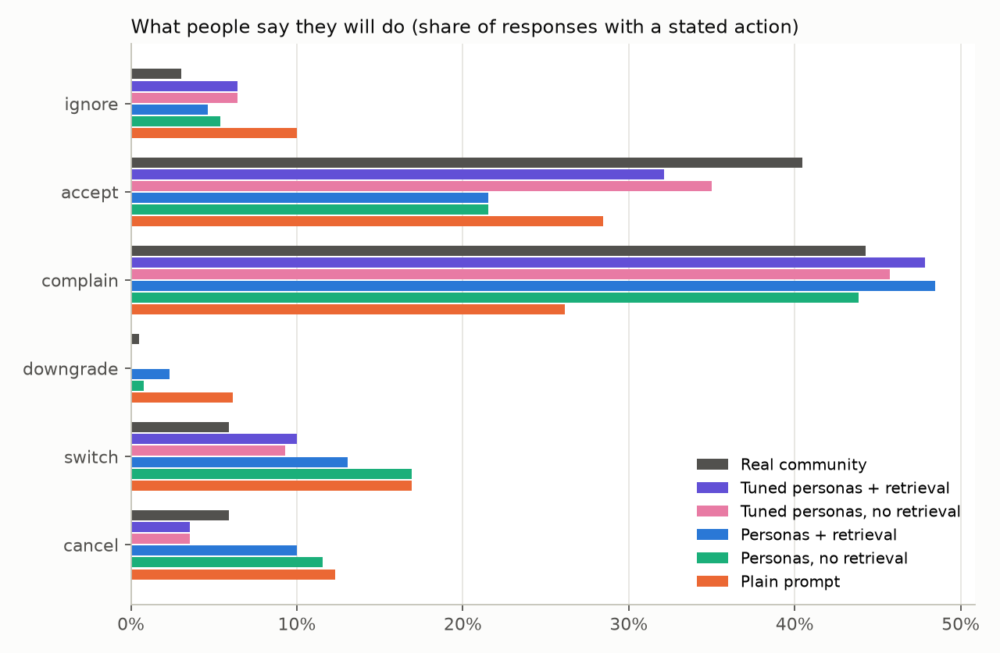
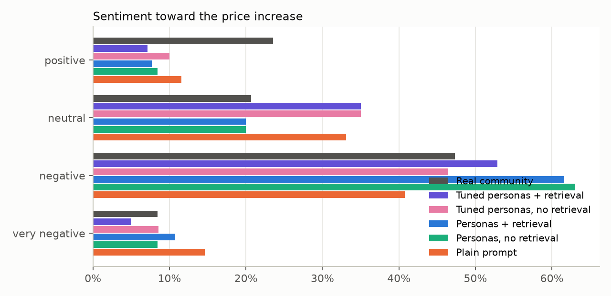
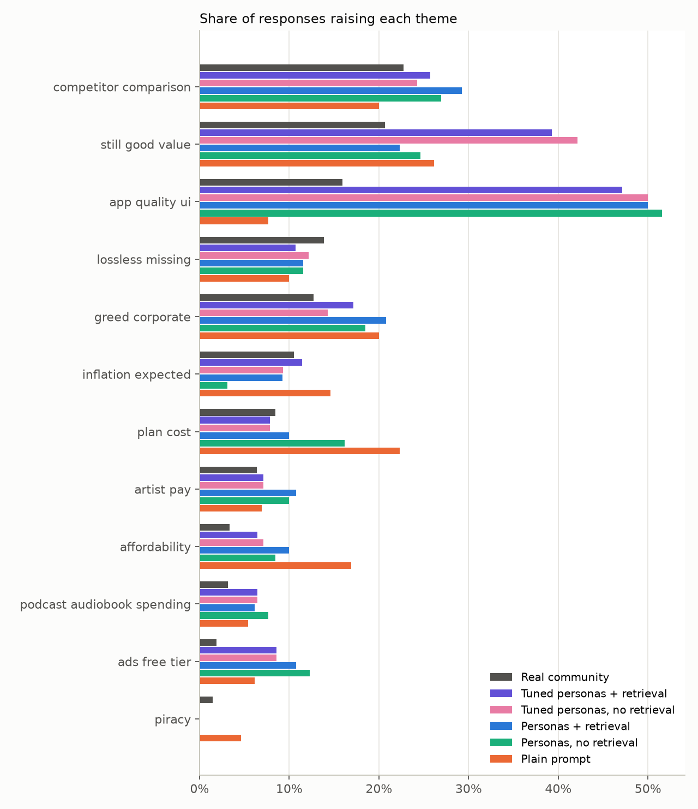

# Simulated vs real reaction (2023)

Real side: 1,345 labeled post-event rows; 945 are relevant reactions in r/spotify + r/truespotify (618 authors); 628 express a stance or action and are the comparison set (the other 317 are questions or information; including them, real sentiment is {'very_negative': '6%', 'negative': '35%', 'neutral': '44%', 'positive': '16%'}). Sim side: 670 responses (5 conditions x 5 repetitions; 26 personas in v1, 28 in v2).

## Scorecard

| | Tuned personas + retrieval | Tuned personas, no retrieval | Personas + retrieval | Personas, no retrieval | Plain prompt | Real-data noise floor |
|---|---|---|---|---|---|---|
| Action TVD (lower = closer) | 0.11 ± 0.04 | 0.08 ± 0.06 | 0.19 ± 0.04 | 0.19 ± 0.06 | 0.30 ± 0.06 | 0.06 |
| Sentiment TVD | 0.20 ± 0.05 | 0.14 ± 0.08 | 0.17 ± 0.04 | 0.16 ± 0.01 | 0.19 ± 0.06 | 0.05 |
| Theme rank correlation (Spearman, higher = closer) | 0.88 | 0.89 | 0.82 | 0.76 | 0.69 |  |
| Top-5 themes shared with real | 4/5 | 5/5 | 5/5 | 4/5 | 3/5 |  |
| Mean sentiment (real -0.41) | -0.56 | -0.54 | -0.75 | -0.72 | -0.58 |  |
| Accept / defend (real 40%) | 32% | 35% | 22% | 22% | 28% |  |
| Positive sentiment (real 24%) | 7% | 10% | 8% | 8% | 12% |  |
| Leave rate: cancel+switch+downgrade (real 12%) | 14% | 13% | 25% | 29% | 35% |  |
| Leave rate, firm statements only (conditional threats counted as complain, as the real labeler did) | 10% | 9% | 13% | 15% | 30% |  |

± is the sd of the TVD across the 5 repetitions. The noise floor is the average TVD between two random halves of the real data: a simulation cannot be expected to beat it.

## Actions

| action    | Real community   | Tuned personas + retrieval   | Tuned personas, no retrieval   | Personas + retrieval   | Personas, no retrieval   | Plain prompt   |
|:----------|:-----------------|:-----------------------------|:-------------------------------|:-----------------------|:-------------------------|:---------------|
| cancel    | 6%               | 4%                           | 4%                             | 10%                    | 12%                      | 12%            |
| switch    | 6%               | 10%                          | 9%                             | 13%                    | 17%                      | 17%            |
| downgrade | 0%               | 0%                           | 0%                             | 2%                     | 1%                       | 6%             |
| complain  | 44%              | 48%                          | 46%                            | 48%                    | 44%                      | 26%            |
| accept    | 40%              | 32%                          | 35%                            | 22%                    | 22%                      | 28%            |
| ignore    | 3%               | 6%                           | 6%                             | 5%                     | 5%                       | 10%            |

## Sentiment

| sentiment     | Real community   | Tuned personas + retrieval   | Tuned personas, no retrieval   | Personas + retrieval   | Personas, no retrieval   | Plain prompt   |
|:--------------|:-----------------|:-----------------------------|:-------------------------------|:-----------------------|:-------------------------|:---------------|
| very_negative | 8%               | 5%                           | 9%                             | 11%                    | 8%                       | 15%            |
| negative      | 47%              | 53%                          | 46%                            | 62%                    | 63%                      | 41%            |
| neutral       | 21%              | 35%                          | 35%                            | 20%                    | 20%                      | 33%            |
| positive      | 24%              | 7%                           | 10%                            | 8%                     | 8%                       | 12%            |

## Themes

|                            | Real community   | Tuned personas + retrieval   | Tuned personas, no retrieval   | Personas + retrieval   | Personas, no retrieval   | Plain prompt   |
|:---------------------------|:-----------------|:-----------------------------|:-------------------------------|:-----------------------|:-------------------------|:---------------|
| competitor_comparison      | 23%              | 26%                          | 24%                            | 29%                    | 27%                      | 20%            |
| still_good_value           | 21%              | 39%                          | 42%                            | 22%                    | 25%                      | 26%            |
| app_quality_ui             | 16%              | 47%                          | 50%                            | 50%                    | 52%                      | 8%             |
| lossless_missing           | 14%              | 11%                          | 12%                            | 12%                    | 12%                      | 10%            |
| greed_corporate            | 13%              | 17%                          | 14%                            | 21%                    | 18%                      | 20%            |
| inflation_expected         | 11%              | 11%                          | 9%                             | 9%                     | 3%                       | 15%            |
| plan_cost                  | 8%               | 8%                           | 8%                             | 10%                    | 16%                      | 22%            |
| artist_pay                 | 6%               | 7%                           | 7%                             | 11%                    | 10%                      | 7%             |
| affordability              | 3%               | 6%                           | 7%                             | 10%                    | 8%                       | 17%            |
| podcast_audiobook_spending | 3%               | 6%                           | 6%                             | 6%                     | 8%                       | 5%             |
| ads_free_tier              | 2%               | 9%                           | 9%                             | 11%                    | 12%                      | 6%             |
| piracy                     | 1%               | 0%                           | 0%                             | 0%                     | 0%                       | 5%             |

## Switch targets

|                 |   Real |   Tuned personas + retrieval |   Tuned personas, no retrieval |   Personas + retrieval |   Personas, no retrieval |   Plain prompt |
|:----------------|-------:|-----------------------------:|-------------------------------:|-----------------------:|-------------------------:|---------------:|
| Apple Music     |     13 |                           10 |                             11 |                     11 |                       16 |              7 |
| Amazon Music    |      6 |                            0 |                              0 |                      0 |                        0 |              4 |
| YouTube Music   |      6 |                            2 |                              1 |                      0 |                        0 |              5 |
| Tidal           |      5 |                            1 |                              1 |                      5 |                        6 |              4 |
| Musi            |      2 |                            0 |                              0 |                      0 |                        0 |              0 |
| Deezer          |      0 |                            1 |                              0 |                      0 |                        0 |              2 |
| YouTube Premium |      0 |                            0 |                              0 |                      1 |                        0 |              0 |

## Hindsight-leakage check

Share of comments containing cues that need knowledge from after the announcement. The real column is a reference only (real users legitimately knew these things).

| cue                                   | Tuned personas + retrieval   | Tuned personas, no retrieval   | Personas + retrieval   | Personas, no retrieval   | Plain prompt   | Real community   |
|:--------------------------------------|:-----------------------------|:-------------------------------|:-----------------------|:-------------------------|:---------------|:-----------------|
| repeat hike ('again', 'another hike') | 4%                           | 5%                             | 5%                     | 4%                       | 0%             | 1%               |
| market reaction (stock, investors)    | 0%                           | 0%                             | 0%                     | 0%                       | 0%             | 1%               |
| later prices ($11.99 / $12.99)        | 0%                           | 0%                             | 0%                     | 0%                       | 0%             | 1%               |
| social backlash (twitter, trending)   | 0%                           | 0%                             | 0%                     | 0%                       | 0%             | 0%               |

Flagged simulated comments:

- `norag r1 s5_p6`: Another price hike for an app that gets worse with every redesign. Recommendations are stale, shuffle and autoplay are a mess, and the home page is still confusing. I stay for the playlists and podcas
- `norag r1 s5_p7`: Another price increase and the app still breaks after every update. Reinstalling is the only thing that fixes playback half the time, and my downloads still won't play offline. Turn off auto update an
- `norag r3 s1_p6`: Another increase and still no lossless. Apple Music and Tidal already do hi-fi at this price or less, so Spotify is asking more for a worse product. I already moved my listening to Tidal for this exac
- `norag r4 s3_p2`: I already cancelled my family plan over the podcast-stuffed home screen, so this price bump just confirms I'm not paying for a service that keeps shoving shows at me. Show me the music, not another pr
- `norag r4 s1_p6`: Another price increase and still no lossless. Tidal and Deezer already give hi-fi at similar prices, so Spotify is asking for more while the sound stays the same. I'm moving to Tidal full time.
- `rag r1 s5_p6`: Another price hike while the UI keeps getting worse and the recommendations keep going stale. If the app doesn't get better I'm moving to YouTube Music, the constant changes are getting old.
- `rag r1 s2_p2`: Another price hike for a product that keeps breaking my playlists and adding songs I didn't ask for. Last time it was the missing features that made me leave, and nothing has changed since. Not paying
- `rag r1 s5_p3`: Spotify raises its price again and the artists still get fractions of a cent per stream. Where does the extra money go? Not to the people making the music, that's for sure.
- `rag r5 s2_p3`: Cool, another price hike and my liked songs still don't show up on album track lists. Paying more for less, great. Still here for my daily mix, but one more feature gets yanked and I'm out again.
- `rag r5 s5_p6`: Price going up again and the UI is still a mess. Recommendations are my whole reason for staying and they keep getting staler. If the next redesign doesn't fix it I'm going to YouTube Music, no questi
- `rag r5 s1_p6`: Another price hike and still no lossless on Spotify, while Tidal and Deezer already do hi-fi. I want lossless included without a fee or I'm not paying for it. At this point I'm only here for the playl
- `norag_v2 r1 s3_p2`: ANOTHER increase and the home screen is still a podcast billboard. show me the music first. im not cancelling yet because premium is still worth it for music and skipping ads while driving, but im get
- `norag_v2 r1 s2_p2`: another price hike and the enhance feature still mixes recs into my own playlists. i already cancelled over feature changes so i'm close to doing it again. spotify is losing me one annoying change at 
- `norag_v2 r1 s2_p4`: nickel and dime again. they raise the price and i still cant add the same song twice to a playlist. paying more for less, great. apple music is always an option.
- `norag_v2 r2 s5_p7`: Another price hike for an app that breaks after every update. I cancelled before over a bug that never got fixed, so I'm not sure what they're spending it on.
- `norag_v2 r3 s0_p5`: A dollar more is fine by me. I've paid since 2018 and the Spotlight setup is worth it to me, even with features getting pulled and me waiting forever for new ones. Not going anywhere, though I'd love 
- `norag_v2 r3 s5_p2`: Another price hike and still no lossless or HiFi tier. Tidal and Qobuz do hi-fi for similar money, so the gap is getting harder to justify. I'll keep Spotify for Connect and discovery, but Tidal is st
- `norag_v2 r5 s5_p3`: Spotify raised prices again while artists get fractions of a cent per stream. Where does the extra dollar go? This is why I'm on Apple Music now, and I'm not going back until they pay artists more per
- `rag_v2 r1 s5_p1`: Another price hike with no lossless or Spatial Audio, which is what I would expect Premium to include by now. Apple Music sounds and looks better to me but Spotify Connect and Android Auto keep me her
- `rag_v2 r2 s3_p1`: Cool, another price hike and podcast ads still play for Premium users. Paying more to hear ads on a podcast app I never asked for is peak Spotify. I'll stay for the music but I'm not thrilled.
- `rag_v2 r3 s2_p3`: great, price up again and my liked hearts are still missing from album pages. i'd unsubscribe again if they don't bring them back. apple music is still sitting there tempting me.
- `rag_v2 r3 s5_p1`: apple music is about the same price now and has lossless and spatial audio. spotify raising again with no hifi is a hard sell. i switched back to spotify for connect but i'm looking at apple again.
- `rag_v2 r5 s5_p3`: Another price hike and artists still get fractions of a cent per stream. They can raise it to $20 for all I care, the money is going to the label and the executives, not the people who make the music.
