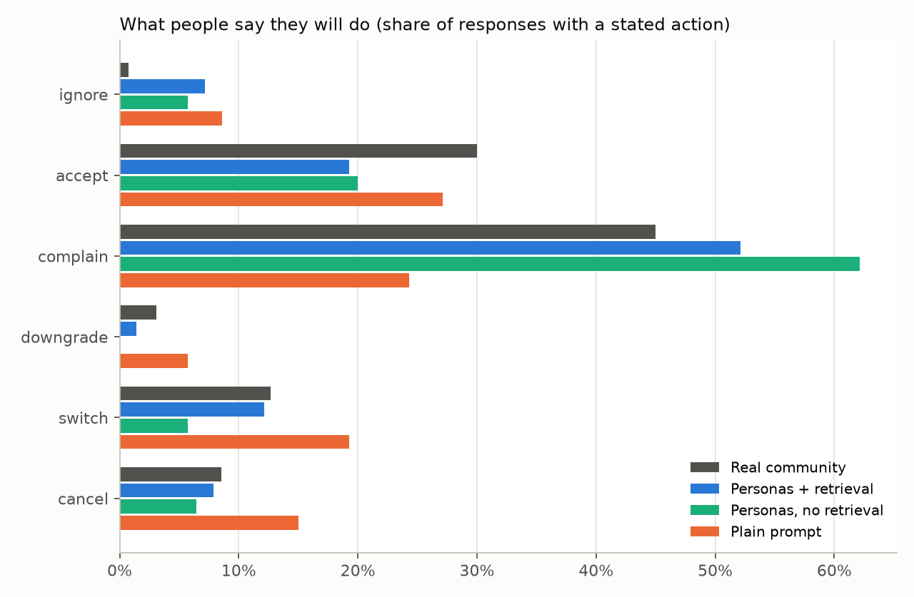
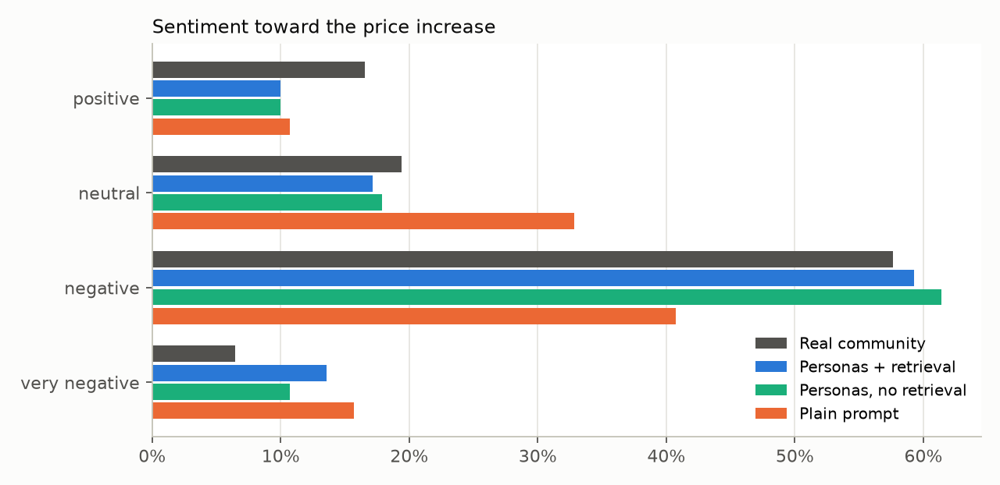
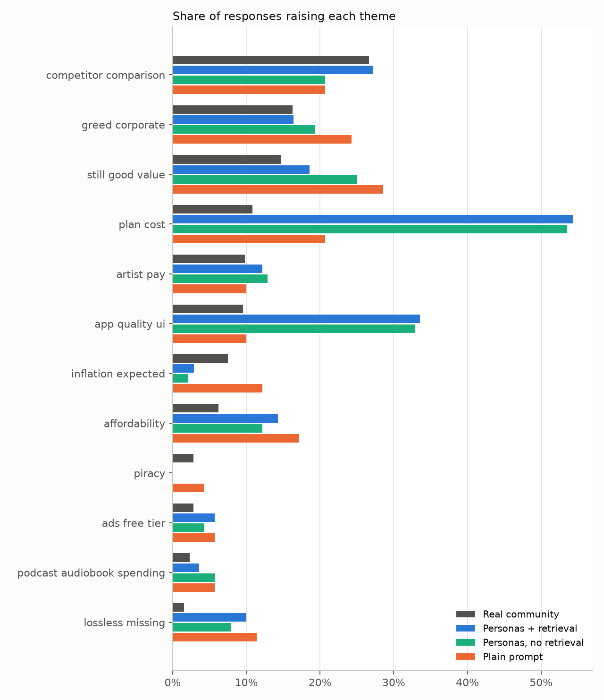

# Simulated vs real reaction (2026)

Real side: 895 labeled post-event rows; 606 are relevant reactions in r/spotify + r/truespotify (412 authors); 387 express a stance or action and are the comparison set (the other 219 are questions or information; including them, real sentiment is {'very_negative': '4%', 'negative': '39%', 'neutral': '46%', 'positive': '11%'}). Sim side: 420 responses (3 conditions x 5 repetitions; 26 personas in v1, 28 in v2).

## Scorecard

| | Personas + retrieval | Personas, no retrieval | Plain prompt | Real-data noise floor |
|---|---|---|---|---|
| Action TVD (lower = closer) | 0.14 ± 0.04 | 0.22 ± 0.05 | 0.24 ± 0.04 | 0.07 |
| Sentiment TVD | 0.09 ± 0.03 | 0.08 ± 0.02 | 0.23 ± 0.07 | 0.06 |
| Theme rank correlation (Spearman, higher = closer) | 0.70 | 0.69 | 0.75 |  |
| Top-5 themes shared with real | 4/5 | 4/5 | 4/5 |  |
| Mean sentiment (real -0.54) | -0.76 | -0.73 | -0.61 |  |
| Accept / defend (real 30%) | 19% | 20% | 27% |  |
| Positive sentiment (real 17%) | 10% | 10% | 11% |  |
| Leave rate: cancel+switch+downgrade (real 24%) | 21% | 12% | 40% |  |
| Leave rate, firm statements only (conditional threats counted as complain, as the real labeler did) | 18% | 10% | 37% |  |

± is the sd of the TVD across the 5 repetitions. The noise floor is the average TVD between two random halves of the real data: a simulation cannot be expected to beat it.

## Actions

| action    | Real community   | Personas + retrieval   | Personas, no retrieval   | Plain prompt   |
|:----------|:-----------------|:-----------------------|:-------------------------|:---------------|
| cancel    | 9%               | 8%                     | 6%                       | 15%            |
| switch    | 13%              | 12%                    | 6%                       | 19%            |
| downgrade | 3%               | 1%                     | 0%                       | 6%             |
| complain  | 45%              | 52%                    | 62%                      | 24%            |
| accept    | 30%              | 19%                    | 20%                      | 27%            |
| ignore    | 1%               | 7%                     | 6%                       | 9%             |

## Sentiment

| sentiment     | Real community   | Personas + retrieval   | Personas, no retrieval   | Plain prompt   |
|:--------------|:-----------------|:-----------------------|:-------------------------|:---------------|
| very_negative | 6%               | 14%                    | 11%                      | 16%            |
| negative      | 58%              | 59%                    | 61%                      | 41%            |
| neutral       | 19%              | 17%                    | 18%                      | 33%            |
| positive      | 17%              | 10%                    | 10%                      | 11%            |

## Themes

|                            | Real community   | Personas + retrieval   | Personas, no retrieval   | Plain prompt   |
|:---------------------------|:-----------------|:-----------------------|:-------------------------|:---------------|
| competitor_comparison      | 27%              | 27%                    | 21%                      | 21%            |
| greed_corporate            | 16%              | 16%                    | 19%                      | 24%            |
| still_good_value           | 15%              | 19%                    | 25%                      | 29%            |
| plan_cost                  | 11%              | 54%                    | 54%                      | 21%            |
| artist_pay                 | 10%              | 12%                    | 13%                      | 10%            |
| app_quality_ui             | 10%              | 34%                    | 33%                      | 10%            |
| inflation_expected         | 7%               | 3%                     | 2%                       | 12%            |
| affordability              | 6%               | 14%                    | 12%                      | 17%            |
| ads_free_tier              | 3%               | 6%                     | 4%                       | 6%             |
| piracy                     | 3%               | 0%                     | 0%                       | 4%             |
| podcast_audiobook_spending | 2%               | 4%                     | 6%                       | 6%             |
| lossless_missing           | 2%               | 10%                    | 8%                       | 11%            |

## Switch targets

|                 |   Real |   Personas + retrieval |   Personas, no retrieval |   Plain prompt |
|:----------------|-------:|-----------------------:|-------------------------:|---------------:|
| Apple Music     |     15 |                      5 |                        2 |              7 |
| Tidal           |      8 |                      2 |                        0 |              6 |
| YouTube Music   |      7 |                      5 |                        0 |              6 |
| YouTube Premium |      6 |                      0 |                        1 |              0 |
| Qobuz           |      4 |                      0 |                        0 |              0 |
| Amazon Music    |      0 |                      3 |                        4 |              5 |
| Apple Podcasts  |      0 |                      2 |                        1 |              0 |
| Deezer          |      0 |                      0 |                        0 |              1 |

## Hindsight-leakage check

Share of comments containing cues that need knowledge from after the announcement. The real column is a reference only (real users legitimately knew these things).

| cue                                 | Personas + retrieval   | Personas, no retrieval   | Plain prompt   | Real community   |
|:------------------------------------|:-----------------------|:-------------------------|:---------------|:-----------------|
| market reaction (stock, investors)  | 0%                     | 0%                       | 0%             | 0%               |
| social backlash (twitter, trending) | 0%                     | 0%                       | 0%             | 0%               |
| later prices ($13.99+)              | 0%                     | 0%                       | 0%             | 0%               |
| the November FT leak                | 0%                     | 0%                       | 0%             | 0%               |

Flagged simulated comments:

